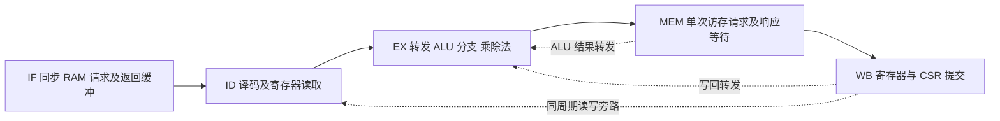

# 五级流水线改造说明

日期：2026-10-15。分支：`codex/five-stage-pipeline`。
三级并行总线基线为本分支的 `7e77549`，此前 main 保持 `e069717`。

## 1. 参考与第一版范围

- [VexRiscv](https://github.com/SpinalHDL/VexRiscv)：参考五级顺序流水线、有效/就绪控制，
  以及 HazardSimplePlugin 的依赖与旁路思想。
- [UltraEmbedded RV32IM](https://github.com/ultraembedded/riscv)：参考分离执行结果、
  访存完成和提交，及单发射内核的互锁处理；不是以双发射 biRISC-V 替换本项目。
- [PULP OBI mux](https://github.com/pulp-platform/obi/blob/main/src/obi_mux.sv)：
  参考按接受时的请求来源返回响应。当前 RIB 为本工程协议实现，不宣称 OBI 兼容。

本次以 Verilog 实现顺序单发射 IF→ID→EX→MEM→WB，保持 RV32IM/Zicsr 软件、
RAM 初始化文件、SoC 外部引脚和统计 CSR 地址。正常算术指令可重叠执行。
分支在 EX 解决，暂不预测；两路 Cache、BTB/BHT、分布式 RAM 寄存器组均未加入。
这些功能应在可复现的五级基线上逐项比较。

## 2. 各级与模块



| 文件 | 改动 |
|---|---|
| [tinyriscv_core.v](../hardware/pds/source/core/tinyriscv_core.v) | 五级有效位与 payload、转发、互锁、MEM 事务、WB、精确同步异常和中断排空 |
| [ifu.v](../hardware/pds/source/core/ifu.v) | 保留旧模块供历史参考，新增实际使用的 ifu_p5；请求 PC 元数据、两个 skid 槽及错误路径响应丢弃 |
| [idu.v](../hardware/pds/source/core/idu.v) | 保留译码，修正 NOP 同时属于 ALU/SYS 导致组号相或的问题 |
| [csr_reg.v](../hardware/pds/source/core/csr_reg.v) | 导出 mie，CSR 正常写由 WB 发起；统计地址和饱和行为保留 |
| [rib.v](../hardware/pds/source/sys_bus/rib.v) | 添加 REGISTERED_RESPONSE，记录每个从设备的响应 owner，每主/从最多一项未完成事务 |
| [tinyriscv_soc_top.v](../hardware/pds/source/top/tinyriscv_soc_top.v) | 五级 SoC 固定选择注册响应归属；PARALLEL_ACCESS 仍可选全局/逐从设备仲裁 |
| [ram.v](../hardware/pds/source/perips/ram.v)、[rom.v](../hardware/pds/source/perips/rom.v) | 写入按请求接受触发一次；空闲/响应等待时保持读地址 |
| gpio.v、timer.v、uart.v | 读写均按请求接受触发，背压时保持返回数据 |
| [jtag_dm.v](../hardware/pds/source/debug/jtag_dm.v) | SBA 命令准备好后只发送一次，等待返回；DM 控制/CPU 复位无需等待 CPU 总线 |

实际顶层不再实例化旧的 exu、exu_mem、exu_dispatch、exu_commit、clint、pipe_ctrl、
ifu_idu、idu_exu；文件保留且综合时未使用的模块会删除。exu_muldiv、divider、
gpr_reg、csr_reg、idu 继续使用。无需向 PDS 增加新硬件源文件。

## 3. 时序规则

### 取指

同步 RAM 的读输出与 pending_pc 构成正常 IF/ID 寄存边界；返回可直通 ID，
两个 skid 槽只在下游暂停时保存指令，不能把它们固定算作两个额外流水级。
取指最多一个未完成请求，但允许旧响应完成与下一请求在同周期握手。
信用额度同时考虑 FIFO 和未完成响应，防止暂停时溢出。
分支/异常后已接受的旧取指仍被接收并丢弃，不能简单清 pending 后冒充新 PC 的响应。
仅 ram1/ram2 被视为可执行地址区；未对齐取指和未映射执行地址生成异常。

### 转发和暂停

- MEM 的非 load 结果优先于 WB 的同 rd 结果；x0 不参与依赖和写入。
- load 从 WB 转发，避免 RAM 读输出直接串过 EX ALU。
- ID 对 EX/MEM 中未提交的 load 相关者保守互锁；没有承诺固定一拍 load-use。
- EX 因 MEM 等待而驻留时，保存已转发的操作数，防止原生产者退出 WB 后丢值。
- store 的地址和数据、分支比较和 JALR 均使用已转发的操作数。
- 乘除法阻塞 EX 和更年轻指令，更早的 MEM/WB 可排空；若结果先于 MEM 就绪，
  保存结果并停止重复启动单元。

### 访存和提交

EX 计算地址，MEM 发出请求并等待应答，WB 提交。
当前同步 RAM 路径中，MEM 至少包含“请求接受”和“响应接收”两个驻留周期；
属于五个逻辑阶段中的变长 MEM，不能宣传成零等待单周期 load/store。
第一版不提前在 EX 发出投机访存，不添加 store buffer。
store 仅在真实握手时写设备一次；访存期间保留地址、掩码、rd 等元数据。
外部接口没有 error 信号，当前只有本地译码/对齐错误，不能报告总线提供的访问错误。

RIB 可选模式：

- PARALLEL_ACCESS=0：请求使用全局优先级仲裁，但响应仍按接受时 owner 返回。
- PARALLEL_ACCESS=1：不同从设备独立仲裁，优先级仍为 JTAG > 数据 > IF。
- REGISTERED_RESPONSE=0 仅供 RIB 旧组合模式单元对照，不能接五级内核。

RIB 不是多事务乱序返回总线。每个主设备与从设备各一项容量，必须先完成旧应答
才能接受下一项，可在同周期完成/替换。外设的背压和数据保持也随之适配。

### 分支、CSR 和异常

分支在 EX 确认并只在指令前进时重定向，清除年轻指令，保留更早的 MEM/WB。
JAL/JALR 链接值由本指令 PC+4 产生，JALR 清 bit0，并检查无 C 配置下的对齐。
CSR/FENCE/系统指令在 ID 等待更早指令排空，并阻止年轻指令穿越。
CSR 在 EX 读取、WB 写入；CSRRS/CSRRC 的零源寄存器形式不产生写操作。
同步异常携带 fault PC/cause 到 WB，故障指令不写 GPR/CSR/内存。
中断停止 ID 接纳，排空 EX/MEM/WB 后使用 architectural_pc 保存下一条未执行地址。
当前 SoC 的 int_i[0] 定时器映射到机器定时器中断，要求 mstatus.MIE 与 mie.MTIE。
支持直接/向量 mtvec 的定时器入口，MRET 恢复中断使能并返回。
该实现仍是 M 模式的有限 CSR 集，不是完整特权规范、PMP 或 debug 规范实现。

统计 CSR v1 地址/输出格式保留。Memory stall 改在 MEM 等待期间计数；Mul/div stall
在 EX 等待期间计数；BJP 只在有效指令前进时计一次。事件窗口存在重叠，跨架构
比较应以 benchmark cycles 为主，不能把各类事件相加当作 CPI。

## 4. 验证记录

工具：Icarus 10.2、GCC 15.2.0、PDS 2022.2-SP1-Lite build 132640。
脚本：[run_bus_regression.py](../simulation/scripts/run/run_bus_regression.py)。

| 套件 | 结果 |
|---|---|
| unit | 1003 组原仲裁对照通过；6 组响应归属、独立访问、背压、单次写入检查通过 |
| isa | 47 个 RV32I/M 夹具，两种仲裁模式共 94 次通过 |
| data | ram2_parallel 两模式均通过，均为 1172 周期；并行模式观察到 100 次并行授权 |
| pipeline | 五级转发、乘除法、CSR、7 类同步异常/取指故障、冲刷、MRET 与定时器 IRQ，两模式均通过（795 周期） |
| variable latency | 同一定向程序，取指/访存独立背压及延迟响应，通过（1349 周期）；错误路径 sentinel 未被写入 |
| CoreMark smoke | 两模式计算 CRC 均匹配，基准段均 489594 周期；只作为功能/CRC 检查，1 次迭代不是正式分数 |

新增定向文件：
[five_stage_hazards.S](../simulation/tests/pipeline/five_stage_hazards.S)、
[cpu_latency_tb.v](../simulation/tb/soc/cpu_latency_tb.v)、
[rib_owner_tb.v](../simulation/tb/unit/bus/rib_owner_tb.v)。
上述不等于完整 ISA/特权符合性验证；JTAG 串行扫描链与板上运行还需实际验证。

CoreMark smoke 的 seedcrc=e9f5、crclist=e714、crcmatrix=1fd7、crcstate=8e3a，
两模式 crcfinal=e714。全局/并行模式的总仿真周期分别为 578946/578378，
含启动与打印，不应拿它们当 benchmark cycles。并行模式观察到 29036 次并行授权，
IF request wait 从 42902 降至 0，但基准段均 489594 周期；这次仅减少请求等待，
等待已被前端缓冲等机制隐藏，不能据此声称并行总线提升了本次基准段成绩。
日志出现小于 10 秒的错误提示和 Errors detected，是因为 ITERATIONS=1 的运行时长
不足，CRC 检查通过不等于 CoreMark 正式有效运行。

```text
python simulation/scripts/run/run_bus_regression.py --suite unit
python simulation/scripts/run/run_bus_regression.py --suite isa
python simulation/scripts/run/run_bus_regression.py --suite data
python simulation/scripts/run/run_bus_regression.py --suite pipeline
python simulation/scripts/run/run_bus_regression.py --suite coremark --coremark-timeout 1800
```

按机器配置追加 --iverilog/--vvp/--gcc。日志和报告在 simulation/results 的忽略目录，
ELF/BIN/HEX 在 simulation/firmware/generated，正式 sw/coremark 软件产物没有覆盖。

## 5. PDS 实现

沿用 PGL50H-6 FBG484、相同 PLL/RAM IP、20 ns 时钟与原 tinydram.fdc，
在 FPGA/tmp/pds_five_stage_v3 隔离实现；未生成或下载 bitstream。
PDS 默认 FSM 推断对新流水线反馈触发内部错误；依据 ADS 支持的 syn_state_machine=0，
在新 core/frontend 与响应 owner 上保留显式寄存器编码后，默认编译/综合流程完成。
没有全局关闭 UART/JTAG/除法器的 FSM 优化。

| 项目 | 三级+并行总线基线 | 五级第一版 |
|---|---:|---:|
| LUT | 5241 | 5082 |
| FF | 3100 | 3690 |
| DRM | 48 | 48 |
| APM | 4 | 4 |
| 50 MHz CPU Setup WNS | +1.317 ns | +0.549 ns |
| CPU Hold WHS，Slow | +0.312 ns | +0.252 ns |
| CPU Hold WHS，Fast | +0.242 ns | +0.195 ns |
| CPU 估计最高频率 | 53.525 MHz | 51.411 MHz |

全部已有约束满足，0 latch。资源是全 SoC 汇总：LUT 减少 159，FF 增加 590；
当前五级没有提高估计最高频率，仍需后续按关键路径优化，不能只凭级数宣称加速。
部分外部 IO 延迟未约束，此结论不等于完整 IO/CDC 签核。
原始报告另存 simulation/results/reports/pds_five_stage/（忽略目录）。

## 6. 上板与后续顺序

软件地址、RAM 容量与初始化方式保留，PDS 工程仍在 hardware/pds/CoreMark_PGL50H.pds。
需要重新综合/布局布线生成新 bitstream；本次没有要求重新生成 RAM IP。
上板仍比较相同 GCC 参数、50 MHz、2000 次迭代的 CRC 与 cycles64，运行至少 10 秒。
原 CoreMark 正文及 CPU statistics v1 输出保留。
先完成板上基线，再分别尝试 MEM/取指时序优化、分支预测、GPR 分布式 RAM、
ALU 共享移位器；每项独立记录资源、频率与实际周期变化。
